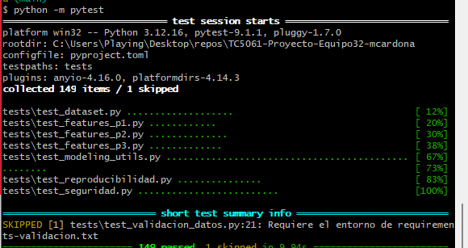
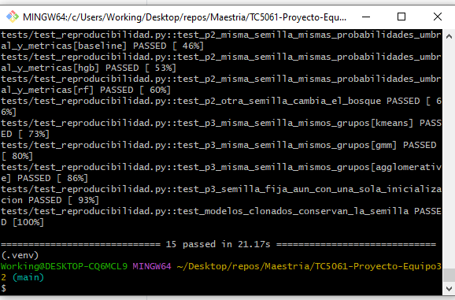
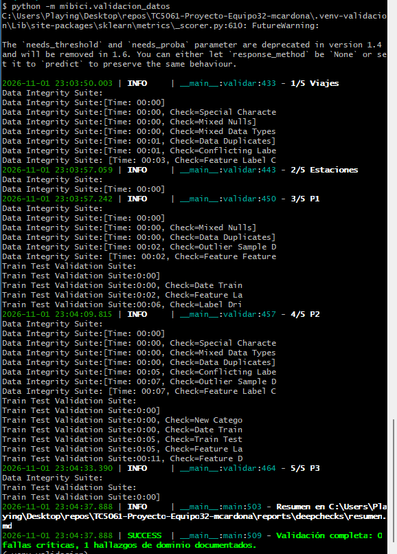
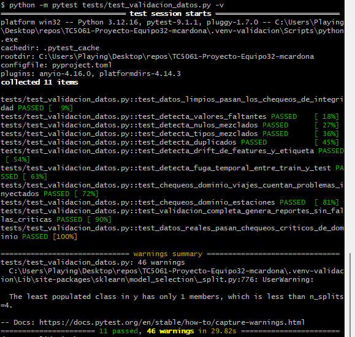
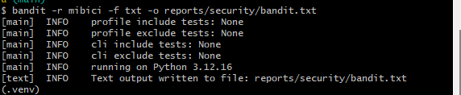
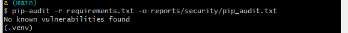
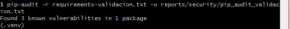
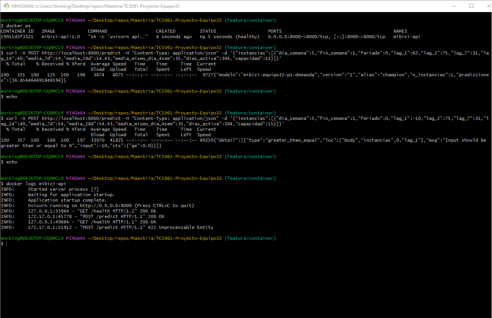
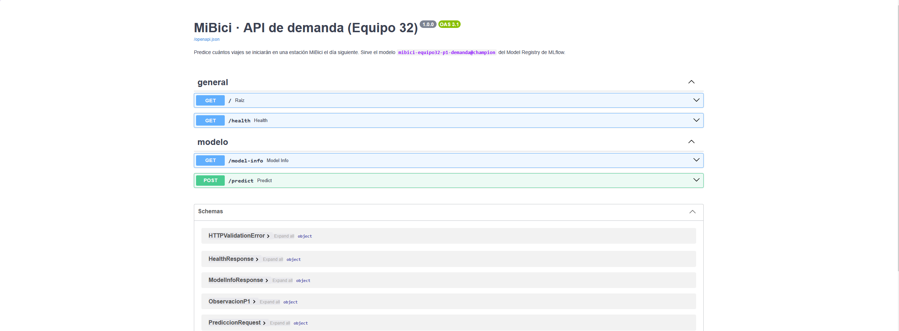

# TC5061-Proyecto-Equipo32
Proyecto integrador de TC5061 (Operaciones de aprendizaje automático): propuesta de solución de ML
sobre los datos abiertos de [MiBici](https://mibici.net/es/datos-abiertos/), el sistema de bicicleta
pública del Área Metropolitana de Guadalajara. Datos: ene–dic 2025 (4,532,032 viajes, 484 estaciones).

El proyecto responde tres preguntas de negocio:

| # | Pregunta | Tipo de tarea | Usuario |
|---|----------|---------------|---------|
| P1 | ¿Cuántos viajes se iniciarán en una estación o zona en un periodo futuro? | Regresión | Operador del sistema (planeación de flota) |
| P2 | ¿Una estación estará en riesgo de quedarse sin bicicletas o sin anclajes? | Clasificación | Equipo de rebalanceo |
| P3 | ¿Qué grupos de estaciones comparten patrones de uso y dónde se ubican? | Clustering | Planeación urbana y expansión |

El ML Canvas y el diagrama de arquitectura se encuentran en `references/`.

<a target="_blank" href="https://cookiecutter-data-science.drivendata.org/">
    
</a>

Última actualización: semana 8, el modelo de P1 se sirve como API REST en un contenedor (ver
[API de predicción en contenedor](#api-de-predicción-en-contenedor)).

## Project Organization

```
├── .env.example       <- Plantilla de variables de entorno (sin valores; copiar a .env)
├── LICENSE            <- Open-source license if one is chosen
├── Containerfile      <- Imagen de la API de predicción (Docker o Podman)
├── Makefile           <- Makefile with convenience commands like `make data` or `make train`
├── README.md          <- The top-level README for developers using this project.
├── api                <- API REST con FastAPI que sirve el modelo de P1
│
├── data
│   ├── external       <- Data from third party sources.
│   ├── interim        <- Intermediate data that has been transformed.
│   ├── processed      <- The final, canonical data sets for modeling.
│   └── raw            <- The original, immutable data dump.
│
├── docs               <- A default mkdocs project; see www.mkdocs.org for details
│   └── capturas       <- Evidencia de ejecución de pruebas y chequeos
│
├── models             <- Trained and serialized models, model predictions, or model summaries
│   └── serving        <- Modelo exportado del Model Registry que se empaqueta en la imagen
│
├── notebooks          <- Jupyter notebooks. Naming convention is a number (for ordering),
│                         the creator's initials, and a short `-` delimited description, e.g.
│                         `1.0-jqp-initial-data-exploration`.
│
├── pyproject.toml     <- Project configuration file with package metadata for 
│                         mibici and configuration for tools like black
│
├── references         <- Data dictionaries, manuals, and all other explanatory materials.
│
├── reports            <- Generated analysis as HTML, PDF, LaTeX, etc.
│   ├── deepchecks     <- Resumen de la validación de datos (los HTML se regeneran)
│   ├── security       <- Salidas de bandit y pip-audit y SEGURIDAD.md
│   └── figures        <- Generated graphics and figures to be used in reporting
│
├── requirements.txt   <- The requirements file for reproducing the analysis environment, e.g.
│                         generated with `pip freeze > requirements.txt`
│
├── requirements-validacion.txt <- Entorno aislado (Python 3.12) para DeepChecks
│
├── requirements-api.txt <- Dependencias del servicio de la API (imagen del contenedor)
│
├── tests              <- Pruebas de PyTest: unitarias, reproducibilidad, seguridad y DeepChecks
│
├── setup.cfg          <- Configuration file for flake8
│
└── mibici   <- Source code for use in this project.
    │
    ├── __init__.py             <- Makes mibici a Python module
    │
    ├── config.py               <- Store useful variables and configuration
    │
    ├── dataset.py              <- Scripts to download or generate data
    │
    ├── features.py             <- Code to create features for modeling
    │
    ├── validacion_datos.py     <- Validación de calidad e integridad de datos con DeepChecks
    │
    ├── modeling                
    │   ├── __init__.py 
    │   ├── p1_regresion.py     <- P1: viajes diarios por estación (baseline + 2 candidatos, MLflow)
    │   ├── p2_clasificacion.py <- P2: riesgo de quedarse sin bicis/anclajes (MLflow)
    │   ├── p3_clustering.py    <- P3: clustering de estaciones por patrón de uso (MLflow)
    │   ├── export_model.py     <- Descarga del registry el modelo que sirve la API
    │   ├── predict.py          <- Code to run model inference with trained models          
    │   └── train.py            <- Code to train models
    │
    └── plots.py                <- Code to create visualizations
```

--------


## Reproducibilidad y MLOps

El proyecto utiliza una estructura basada en Cookiecutter Data Science. La lógica final se mantiene dentro del paquete `mibici`; los notebooks se reservan para exploración.

El entorno fue probado con Python 3.14.4. Las dependencias directas se encuentran fijadas por versión en `requirements.txt`.
También se verificó la ejecución completa (ingesta, pruebas, P1, P2 y P3) con **Python 3.12.13** desde un clon limpio.

### Instalación

```bash
python -m venv .venv
source .venv/bin/activate
python -m pip install -r requirements.txt


```

La consistencia del entorno puede verificarse con:

```bash
python -m pip check
```

### Datos

La ingesta se ejecuta desde el módulo:

```bash
python -m mibici.dataset
```

`dataset.py` descarga los datos públicos de MiBici definidos en `config.py`, genera los archivos procesados y crea `data/manifest.json`.

El manifiesto incluye una `data_version` calculada a partir de los archivos de entrada. Esta versión se registra posteriormente en MLflow para mantener trazabilidad entre datos y experimentos.

Los datos crudos, intermedios y procesados no se versionan en Git.

## Reproducción completa desde un clon limpio

```bash
git clone https://github.com/alexcard33/TC5061-Proyecto-Equipo32-mcardona.git
cd TC5061-Proyecto-Equipo32-mcardona
python -m venv .venv
source .venv/bin/activate          # Git Bash en Windows: source .venv/Scripts/activate
python -m pip install -r requirements.txt

make mlflow-ui                     # 1. servidor de tracking en http://127.0.0.1:5000 (dejar esta terminal abierta)

# En otra terminal, con el entorno virtual activado:
export MLFLOW_TRACKING_URI=http://127.0.0.1:5000
mlflow run . -e ingest --env-manager local     # 2. ingesta: data/raw -> data/processed + data/manifest.json
git checkout -- data/manifest.json             #    restaura la marca de tiempo (data_version no cambia)
python -m pytest tests                          # 3. pruebas de no fuga de información (P1)

# 4. modelo por defecto de cada pregunta (los comandos de los modelos elegidos están en
#    "Modelos seleccionados y reproducción")
mlflow run . -e train -P question=p1 --experiment-name mibici-equipo32 --env-manager local
mlflow run . -e train -P question=p2 --experiment-name mibici-equipo32 --env-manager local
mlflow run . -e train -P question=p3 --experiment-name mibici-equipo32 --env-manager local
```

Fuera del MLflow Project, `make train` entrena todos los modelos de las tres preguntas; equivale a ejecutar `python -m mibici.modeling.p1_regresion`,
`python -m mibici.modeling.p2_clasificacion` y `python -m mibici.modeling.p3_clustering`.
La ingesta debe producir `data_version = 7aa5e436d887`; si el valor cambia, los archivos de MiBici
descargados no son los mismos que se usaron en los experimentos.

**Privacidad.** Los CSV de MiBici incluyen un pseudónimo de usuario, el género y el año de nacimiento.
Como ninguna pregunta los necesita, `dataset.py` los elimina antes de escribir los Parquet procesados
(minimización de datos). Los datos se usan con fines académicos citando la fuente (portal de datos
abiertos de MiBici) y no se redistribuyen en este repositorio.

## MLflow Project

El archivo `MLproject` de la raíz empaqueta el proyecto para que cualquier integrante lo ejecute
con un solo comando. El entorno se declara en `python_env.yaml`, que instala las mismas versiones
fijas de `requirements.txt`.

| Entry point | Comando que ejecuta | Parámetros |
|---|---|---|
| `ingest` | `python -m mibici.dataset` | — |
| `train` | `python -m mibici.modeling.train` | `question` (obligatorio), `model`, `params`, `run_name` |
| `register` | `python -m mibici.modeling.register` | `question` (`all` por defecto) |

Parámetros de `train`:

- `question`: `p1`, `p2` o `p3`.
- `model`: modelo de la pregunta (tabla siguiente). `default` usa `MODELO_DEFAULT` de `config.py`;
  `all` entrena todos los modelos de la pregunta.
- `params`: hiperparámetros como `clave=valor` separados por comas, sin espacios
  (por ejemplo `learning_rate=0.05,max_iter=350`). Solo se indican los que cambian; el resto se toma de
  `config.py` (`P1_HGB_PARAMS`, `P2_HGB_PARAMS`, `P3_KMEANS_PARAMS`, etc.). Rutas, fechas,
  particiones y semilla nunca se pasan como parámetro: siempre vienen de `config.py`.
- `run_name`: nombre del run en MLflow; `auto` usa el definido en `config.py`.

| Pregunta | Modelos (`-P model=`) |
|---|---|
| P1 | `baseline` (naive semanal), `poisson`, `hgb`, `rf`, `search` |
| P2 | `baseline` (regresión logística balanceada), `hgb`, `rf`, `search` |
| P3 | `baseline` (K-Means k=2), `kmeans`, `agglomerative`, `gmm` (k=4), `search` |

Ejemplos (con el servidor de tracking levantado y `MLFLOW_TRACKING_URI` definido):

```bash
# Ingesta
mlflow run . -e ingest --env-manager local

# Baseline y modelo por defecto de una pregunta
mlflow run . -e train -P question=p2 -P model=baseline --experiment-name mibici-equipo32 --env-manager local
mlflow run . -e train -P question=p2 --experiment-name mibici-equipo32 --env-manager local

# Variación de hiperparámetros
mlflow run . -e train -P question=p2 -P model=hgb \
  -P params=learning_rate=0.05,max_iter=350,max_leaf_nodes=63 \
  -P run_name=p2_hgb_lr005 \
  --experiment-name mibici-equipo32 --env-manager local
```

- En Windows (Git Bash o PowerShell) definan `PYTHONUTF8=1` antes de `mlflow run` (`export PYTHONUTF8=1` / `$env:PYTHONUTF8 = "1"`): MLflow imprime emojis en consola y, con la codificación cp1252 de Windows, el run termina con `UnicodeEncodeError`.
- `--experiment-name mibici-equipo32` es obligatorio: los scripts registran en ese experimento
  y MLflow rechaza el run si el experimento del proyecto no coincide.
- `--env-manager local` usa el entorno virtual activo (ya instalado con `requirements.txt`). Sin
  esa opción, MLflow crea un entorno nuevo a partir de `python_env.yaml`, lo que requiere `pyenv`
  o `uv`.
- Cada `mlflow run` crea un run; los parámetros del proyecto (`question`, `model`, `params`)
  quedan registrados junto con los hiperparámetros efectivos del modelo.

## Experimentación y artefactos

Todas las corridas se registran en el experimento `mibici-equipo32` con la misma partición
temporal y las mismas métricas de la entrega anterior, para que la comparación contra el
baseline sea válida.

**Etiquetas para filtrar en la UI** (además de `equipo`, `git_commit` y `data_version`):

| Tag | Valores |
|---|---|
| `question` | `p1`, `p2`, `p3` |
| `model_family` | `naive`, `glm_poisson`, `gradient_boosting`, `random_forest`, `linear`, `kmeans`, `hierarchical`, `gaussian_mixture` |
| `stage_of_work` | `baseline`, `search`, `candidate` |

Ejemplo de filtro en la UI: `tags.question = "p2" and tags.stage_of_work = "candidate"`.

**Búsquedas con nested runs** (`-P model=search`): un run padre por búsqueda y un run hijo por
combinación de la malla definida en `config.py`. El padre registra la mejor combinación
(`mejor_*`), el run hijo ganador (`mejor_run_hijo`) y la tabla `evaluacion/<busqueda>_resultados.csv`.

| Pregunta | Malla | Criterio (sin usar TEST) |
|---|---|---|
| P1 | `P1_HGB_SEARCH_GRID` (HGB) | menor `val_mae` |
| P2 | `P2_HGB_SEARCH_GRID` (HGB) | mayor `val_f1`; desempate `val_pr_auc` |
| P3 | `P3_KMEANS_SEARCH_GRID` (k de K-Means) | mayor `train_silhouette`; desempate menor `train_davies_bouldin` |

**Artefactos de cada corrida candidata:**

```
modelo/        modelo con firma (signature) e input_example (mlflow.sklearn.log_model)
plots/         P1: real vs. predicho y residuos, serie diaria, MAE por día
               P2: matriz de confusión y curva precisión-recall
               P3: PCA por perfil y mapa de grupos
evaluacion/    métricas, predicciones, reportes y tablas de perfiles
data/          manifest.json de la ingesta (data_version)
config/        params_efectivos.json, config.py, MLproject, python_env.yaml, requirements.txt
```

El dataset de entrenamiento se registra con `mlflow.log_input` (solo esquema, número de filas y
digest). Los artefactos no contienen datos personales: la ingesta elimina el pseudónimo, el género
y el año de nacimiento de los usuarios.

**Plan de corridas** (servidor levantado, `MLFLOW_TRACKING_URI` y `PYTHONUTF8=1` definidos):

```bash
OPTS="--experiment-name mibici-equipo32 --env-manager local"

# P1: baseline, 3 candidatas, búsqueda y candidata ajustada con la mejor combinación
mlflow run . -e train -P question=p1 -P model=baseline $OPTS
mlflow run . -e train -P question=p1 -P model=poisson $OPTS
mlflow run . -e train -P question=p1 -P model=hgb $OPTS
mlflow run . -e train -P question=p1 -P model=rf $OPTS
mlflow run . -e train -P question=p1 -P model=search $OPTS
# el log de la búsqueda imprime el comando con la mejor combinación, por ejemplo:
# mlflow run . -e train -P question=p1 -P model=hgb -P params=<mejor> -P run_name=p1_candidato_hgb_tuneado $OPTS

# P2
mlflow run . -e train -P question=p2 -P model=baseline $OPTS
mlflow run . -e train -P question=p2 -P model=hgb $OPTS
mlflow run . -e train -P question=p2 -P model=rf $OPTS
mlflow run . -e train -P question=p2 -P model=search $OPTS
# mlflow run . -e train -P question=p2 -P model=hgb -P params=<mejor> -P run_name=p2_candidato_hgb_tuneado $OPTS

# P3
mlflow run . -e train -P question=p3 -P model=baseline $OPTS
mlflow run . -e train -P question=p3 -P model=kmeans $OPTS
mlflow run . -e train -P question=p3 -P model=agglomerative $OPTS
mlflow run . -e train -P question=p3 -P model=gmm $OPTS
mlflow run . -e train -P question=p3 -P model=search $OPTS
```

## Modelos seleccionados y reproducción

Selección hecha con VALIDATION (P1 y P2) o con métricas de TRAIN y estabilidad (P3); TEST se usó
solo como evaluación final. El análisis completo está en el reporte de la entrega.

| Pregunta | Champion (producción) | Challenger | Métrica de selección |
|---|---|---|---|
| P1 | `p1_candidato_poisson_lineal` (PoissonRegressor, alpha=0.001) | `p1_candidato_hgb_tuneado` | VAL MAE 5.104 (baseline 6.232) |
| P2 | `p2_candidato_hgb_tuneado` (HGB, lr=0.05, max_iter=350, max_leaf_nodes=63) | `p2_candidato_hgb` | VAL F1 0.468 (baseline 0.415) |
| P3 | `p3_kmeans_final` (K-Means, k=4, n_init=20) | `p3_candidato_gmm_k4` | TRAIN Davies-Bouldin 1.584 (baseline 1.772) |

Comandos para reproducir desde un clon limpio (después de `mlflow run . -e ingest --env-manager local`):

```bash
OPTS="--experiment-name mibici-equipo32 --env-manager local"

# P1 · champion
mlflow run . -e train -P question=p1 -P model=poisson $OPTS

# P2 · champion
mlflow run . -e train -P question=p2 -P model=hgb \
  -P params=learning_rate=0.05,max_iter=350,max_leaf_nodes=63 \
  -P run_name=p2_candidato_hgb_tuneado $OPTS

# P3 · champion
mlflow run . -e train -P question=p3 -P model=kmeans $OPTS

# Registro de los tres modelos y aliases champion/challenger
mlflow run . -e register --env-manager local
```

Nota de reproducibilidad: `mlflow run . -e ingest` reescribe la marca de tiempo `generado` de
`data/manifest.json` aunque `data_version` no cambie, lo que deja el árbol de Git con cambios.
Antes de entrenar, restaure el archivo (`git checkout -- data/manifest.json`) para que las
corridas queden con `git_sucio=False`.

## Model Registry y ciclo de vida

Cada pregunta tiene un registered model con nombre fijo y descripción:

| Pregunta | Registered model |
|---|---|
| P1 | `mibici-equipo32-p1-demanda` |
| P2 | `mibici-equipo32-p2-riesgo` |
| P3 | `mibici-equipo32-p3-grupos` |

**Esquema: aliases.** La versión en producción lleva el alias `champion` y, opcionalmente, la
siguiente mejor alternativa lleva `challenger`. Se eligió este esquema en lugar de las etapas
clásicas (Staging/Production) porque las etapas están obsoletas desde MLflow 2.9, mientras que
los aliases son el mecanismo vigente: el consumidor carga siempre `models:/<nombre>@champion` y
promover o revertir un modelo consiste en mover el alias a otra versión, sin cambiar código ni
borrar versiones. Cada versión conserva su propio linaje.

**Linaje de cada versión** (tags de la versión): `source_run_id`, `source_run_name`,
`source_experiment`, `git_commit`, `git_sucio`, `data_version`, `question`, `model_family`,
`stage_of_work` y, en P2, `umbral_decision`.

**Registro:** el modelo elegido de cada pregunta se define en `REGISTRO_MODELOS` de `config.py`
(run_name del champion y del challenger) y se registra con:

```bash
mlflow run . -e register --env-manager local
```

El comando es idempotente (si la corrida ya tiene versión, la reutiliza), copia el linaje,
asigna los aliases y verifica la carga del modelo en producción:

```python
import mlflow
modelo = mlflow.pyfunc.load_model("models:/mibici-equipo32-p1-demanda@champion")
```

## P1 — Regresión de viajes diarios por estación

**Pregunta:** ¿cuántos viajes se iniciarán en cada estación el día siguiente? Usuario: operador del
sistema (planeación de flota y turnos). Granularidad: estación × día; horizonte: 1 día (la predicción
del día D se emite al cierre de D-1).

```bash
python -m mibici.modeling.p1_regresion
```

- **Partición temporal:** TRAIN ene-sep 2025, VAL oct 2025 (selección del modelo), TEST nov-dic 2025.
- **Variables** (`mibici/features.py`, funciones `p1_*`): calendario del día objetivo (día de la semana,
  fin de semana, feriado), rezagos de 1, 2, 7 y 14 días, medias móviles de 7 y 28 días que terminan en
  D-1, promedio del mismo día de las 4 semanas previas, antigüedad y capacidad de la estación.
  `p1_agregar_features` lanza `LeakageError` si se pide un rezago menor que el horizonte.
- **Modelos:** baseline ingenuo semanal (`t − 7 días`), candidato lineal `PoissonRegressor`
  (conteos en `log1p`) y candidato `HistGradientBoostingRegressor` con pérdida Poisson.
- **Métricas:** `train_/val_/test_` + `mae`, `rmse`, `wape`, `r2`, `sesgo` y `mape_total_dia`.
- **Runs:** `p1_baseline_naive_semanal`, `p1_candidato_poisson_lineal`, `p1_candidato_hgb_poisson`.

## P2 — Clasificación de riesgo de disponibilidad

**Pregunta:** ¿una estación estará en riesgo de quedarse sin bicicletas o sin anclajes en las próximas
2 horas? Usuario: equipo de rebalanceo.

```bash
python -m mibici.modeling.p2_clasificacion
```

- **Etiqueta:** riesgo si `|neto(t+1 … t+2)| >= 0.4 × capacidad` (`p2_agregar_etiqueta`).
- **Partición temporal:** TRAIN ene-sep, VAL oct (umbral de decisión que maximiza F1), TEST nov-dic 2025.
- **Modelos:** baseline regresión logística balanceada y candidato `HistGradientBoostingClassifier`.
- **Runs:** `p2_baseline_logreg`, `p2_candidato_hgb`.

## P3 — Clustering de estaciones

La pregunta P3 busca agrupar estaciones de MiBici de acuerdo con sus patrones de uso y evaluar si esos perfiles se mantienen estables en el tiempo.

La configuración de P3 se encuentra centralizada en `mibici/config.py`. El pipeline final se ejecuta con:

```bash
python -m mibici.modeling.p3_clustering
```

### Partición temporal

Para evitar fuga de información se utiliza una separación temporal sin mezcla aleatoria:

- TRAIN: 1 de enero al 19 de octubre de 2025.
- TEST: 20 de octubre al 31 de diciembre de 2025.
- Ventana histórica reducida: 1 de abril al 19 de octubre de 2025.

Los viajes con duración menor a 60 segundos o mayor a 24 horas se excluyen. También se eliminan viajes que cruzan los límites temporales entre TRAIN y TEST.

### Construcción de características

El feature engineering se encuentra en `mibici/features.py`.

Una estación se considera elegible cuando:

- tiene al menos 30 días de historial;
- presenta menos de 60 días de inactividad al cierre del periodo.

Para cada estación se generan 12 características de comportamiento relacionadas con intensidad, balance, uso en fin de semana y distribución de salidas y llegadas por bloque horario.

Las variables de intensidad se transforman con `log1p` y posteriormente se aplica `StandardScaler`. El escalador se ajusta exclusivamente con TRAIN.

### Comparación de modelos

El pipeline reproduce tres alternativas:

- Baseline: K-Means con k=2.
- Candidato: Agglomerative Clustering con enlace Ward y k=4.
- Modelo final: K-Means con k=4.

La comparación utiliza Silhouette, Davies-Bouldin y Calinski-Harabasz. Para el modelo final también se evalúa estabilidad temporal mediante ARI, NMI y proporción de estaciones que conservan su cluster.

### MLflow Tracking

Todos los runs del proyecto se registran en el experimento único `mibici-equipo32`;
la pregunta atendida se distingue mediante tags (`problema: P1/P2/P3`).

Los runs tienen nombres descriptivos:

- `p3_baseline_kmeans_k2`
- `p3_candidato_agglomerative_k4`
- `p3_kmeans_final`

Además de los tres runs de P3, el experimento contiene los runs de P1 (`p1_baseline_naive_semanal`,
`p1_candidato_poisson_lineal`, `p1_candidato_hgb_poisson`) y de P2 (`p2_baseline_logreg`,
`p2_candidato_hgb`). Todos llevan los tags `equipo = equipo32`, `problema` (P1/P2/P3), `pregunta`,
`etapa` (baseline/candidato), `git_commit` y `data_version`.

Cada run registra, según corresponda:

- versión de los datos (`data_version`);
- commit de Git (`git_commit`);
- pregunta atendida;
- rango temporal;
- semilla y modelo;
- hiperparámetros;
- reglas de filtrado y elegibilidad;
- número de características;
- transformación y escalamiento;
- métricas diferenciadas por conjunto, como `train_silhouette` y `test_silhouette`.

El run final registra como artefactos el modelo serializado, la visualización PCA, el mapa interactivo, el resultado geográfico y la tabla resumen de clusters.

#### Servidor de tracking con base de datos

El Model Registry requiere un backend respaldado por base de datos, por lo que todas las corridas
se registran en un servidor de tracking local con SQLite. La URI del servidor y el nombre del
experimento están centralizados en `mibici/config.py` (`MLFLOW_TRACKING_URI` y `MLFLOW_EXPERIMENT`);
la URI toma el valor de la variable de entorno `MLFLOW_TRACKING_URI` y, si no existe,
usa `http://127.0.0.1:5000`.

1. Levantar el servidor desde la raíz del repositorio (la terminal debe quedar abierta):

```bash
make mlflow-ui
# equivalente:
mlflow server --backend-store-uri sqlite:///mlflow.db --artifacts-destination ./mlartifacts --host 127.0.0.1 --port 5000
```

2. En otra terminal, apuntar el cliente al servidor:

```bash
export MLFLOW_TRACKING_URI=http://127.0.0.1:5000          # bash / zsh
```

```powershell
$env:MLFLOW_TRACKING_URI = "http://127.0.0.1:5000"       # Windows PowerShell
```

3. Consultar la interfaz (experimentos y pestaña **Models** del registry) en `http://127.0.0.1:5000`.

- `--backend-store-uri sqlite:///mlflow.db`: metadatos de corridas y Model Registry en `mlflow.db`.
- `--artifacts-destination ./mlartifacts`: el servidor almacena los artefactos de las corridas nuevas.
- `mlflow.db`, `mlruns/` y `mlartifacts/` están excluidos en `.gitignore`; no se versionan.

## Pruebas, validación de datos y seguridad

La capa de calidad del proyecto tiene tres partes, cada una con su comando y su evidencia:

| Parte | Herramienta | Dónde está | Comando |
|---|---|---|---|
| Pruebas unitarias y de reproducibilidad | PyTest | `tests/` | `python -m pytest` |
| Validación de calidad e integridad de datos | DeepChecks | `mibici/validacion_datos.py`, `tests/test_validacion_datos.py` | `python -m mibici.validacion_datos` |
| Seguridad del código, dependencias y secretos | bandit, pip-audit, PyTest | `tests/test_seguridad.py`, `reports/security/` | ver sección 3 |

Con `make` disponible, los mismos chequeos corren con `make test`, `make security`,
`make validacion` y `make check` (pruebas + seguridad).

### 1. Pruebas unitarias (PyTest)

Todas las pruebas están en `tests/` y corren con **un solo comando** desde la raíz del
repositorio, con el entorno principal activado (la configuración de PyTest está en
`pyproject.toml`). No requieren los datos de `data/` ni un servidor de MLflow: usan datos
sintéticos generados con la semilla fija `SEED` (`tests/sinteticos.py`).

```bash
source .venv/Scripts/activate      # Windows (Git Bash); en Linux/macOS: .venv/bin/activate
python -m pip install -r requirements.txt
python -m pytest                   # suite completa
python -m pytest tests/test_reproducibilidad.py -v   # solo reproducibilidad
```

| Archivo | Qué valida (casos normales y límite) |
|---|---|
| `test_dataset.py` | Ingesta: normalización de columnas (acentos, espacios), fechas inválidas, eliminación de datos personales, CSV en UTF-8 y latin-1, hash SHA-256, descarga idempotente y errores HTTP (red simulada). |
| `test_features_p1.py` | Panel diario de P1: días sin viajes, rangos, calendario y feriados, rezagos y medias móviles sin fuga de información (`LeakageError`). |
| `test_features_p2.py` | Panel horario y etiqueta de riesgo de P2: umbral inclusivo, capacidad 0, horizontes inválidos, variables que no usan el futuro e histórico sin fuga. |
| `test_features_p3.py` | Perfil de uso de P3: filtros de duración, elegibilidad de estaciones, proporciones que suman 1, intensidad por días de exposición y entropías. |
| `test_modeling_utils.py` | Parseo de hiperparámetros, tags de MLflow, particiones temporales, métricas, elección de umbral y fábrica de modelos de P1, P2 y P3. |
| `test_reproducibilidad.py` | **Reproducibilidad del entrenamiento**: con la misma semilla, dos entrenamientos completos dan predicciones, umbral y métricas idénticas en P1, P2 y P3; con otra semilla el RandomForest cambia (control negativo). |
| `test_seguridad.py` | Chequeos de seguridad (ver sección 3). |
| `test_validacion_datos.py` | Validación con DeepChecks (ver sección 2); se omite en el entorno principal. |

Evidencia de ejecución:





### 2. Validación de datos (DeepChecks)

`mibici/validacion_datos.py` valida los mismos datos que usan los pipelines, construidos con
las mismas funciones de `mibici.features`: la tabla de viajes, el catálogo de estaciones y
los conjuntos TRAIN (ene-sep) y TEST (nov-dic) de P1, P2 y P3. Corre la suite
`data_integrity` más `PercentOfNulls` (valores faltantes, nulos y tipos mezclados,
duplicados, etiquetas en conflicto, outliers, correlaciones) y la suite
`train_test_validation` (drift de variables y etiqueta, categorías nuevas, mezcla de muestras
y fuga temporal entre TRAIN y TEST). También calcula chequeos exactos sobre la tabla completa.

DeepChecks 0.19.1 (última versión) no es compatible con numpy 2, pandas 3 ni scikit-learn 1.9,
así que corre en un **entorno aparte con Python 3.12** para no degradar el de entrenamiento:

```bash
python -m pip install uv
python -m uv venv -p 3.12 .venv-validacion
python -m uv pip install --python .venv-validacion -r requirements-validacion.txt
source .venv-validacion/Scripts/activate
python -m mibici.dataset                      # solo si aún no existen los datos
python -m mibici.validacion_datos             # reportes en reports/deepchecks/
python -m pytest tests/test_validacion_datos.py -v
```

Salidas en `reports/deepchecks/`: un reporte HTML por suite (no se versionan por su tamaño;
se regeneran con el comando), y [`resumen.md`](reports/deepchecks/resumen.md) /
`resumen.json` con el estado de cada chequeo. El proceso termina con error si falla un
chequeo **crítico** (nulos, nulos o tipos mezclados, etiquetas en conflicto, fuga temporal).
`tests/test_validacion_datos.py` comprueba además que los chequeos detectan problemas
inyectados a propósito (nulos, duplicados, tipos mezclados, drift y fuga temporal).

**Hallazgos con los datos reales (0 fallas críticas):**

| Hallazgo | Valor | Tratamiento |
|---|---:|---|
| Viajes duplicados (mismos datos, distinto id) | 1,076 | Menos de 0.1 % del total; se documentan y se conservan. |
| Viajes de menos de 60 s | 117,226 | Desanclajes fallidos; los pipelines de P1-P3 los descartan. |
| Viajes de más de 24 h | 6 | Bicicletas no ancladas; los pipelines los descartan. |
| Estaciones con capacidad 0 (ids 99, 109, 116, 138) | 4 | P2 las excluye (no hay umbral de riesgo). |
| Nulos, `viaje_id` duplicado, duraciones negativas, ids fuera de catálogo | 0 | — |
| Drift en `dias_activa` (P1) | KS = 0.99 | Esperado: es la antigüedad de la estación y crece con el tiempo, por eso TEST siempre es mayor que TRAIN. El clasificador de dominio (Multivariate Drift) lo separa por esa misma variable. |
| Variables muy correlacionadas (rezagos y medias en P1, `neto_3h`/`neto_3h_rel` en P2, salidas/llegadas en P3) | > 0.9 | Esperado por construcción; los modelos de árboles lo toleran y el lineal de P1 usa regularización. |
| Muestras de TEST repetidas en TRAIN (P2) | 11.8 % | No es fuga: son horas distintas con el mismo vector de conteos (muchas horas sin movimiento). La fuga temporal se descarta con los chequeos de fechas, que pasan. |





### 3. Chequeos de seguridad

```bash
source .venv/Scripts/activate
bandit -r mibici -f txt -o reports/security/bandit.txt                      # código
pip-audit -r requirements.txt -o reports/security/pip_audit.txt            # dependencias
pip-audit -r requirements-validacion.txt -o reports/security/pip_audit_validacion.txt
python -m pytest tests/test_seguridad.py -v                                 # secretos y .gitignore
```

| Chequeo | Resultado |
|---|---|
| **bandit** sobre `mibici/` | 0 issues. Los 13 avisos de severidad baja iniciales (ejecución de `git` para registrar el commit en MLflow) se corrigieron con la ruta absoluta del ejecutable y el resto quedó justificado con `# nosec`. |
| **pip-audit** entorno principal | Sin vulnerabilidades, tras actualizar mlflow 3.17.1 → 3.17.2 (CVE-2026-53995). |
| **pip-audit** entorno de validación | pyarrow actualizado a 23.0.1. Queda `setuptools<81` como riesgo aceptado: DeepChecks necesita `pkg_resources` y las vulnerabilidades afectan la construcción de paquetes, que el proyecto no hace. |
| **Secretos** (`test_seguridad.py`) | Ningún archivo sensible versionado; `.gitignore` cubre `.env`, llaves, `mlflow.db`, `mlruns/`, datos y entornos virtuales; sin credenciales en los archivos ni en **todo el historial de Git**. |
| **Variables de entorno** | La URI de MLflow y las credenciales se leen del entorno o de un `.env` local (plantilla sin valores: [`.env.example`](.env.example)). |
| **Datos personales** | La ingesta elimina el pseudónimo de usuario, el género y el año de nacimiento. |

Detalle de hallazgos y decisiones: [`reports/security/SEGURIDAD.md`](reports/security/SEGURIDAD.md).







## API de predicción en contenedor

Para esta entrega empaquetamos el modelo de P1 (demanda diaria por estación) como una API REST
con FastAPI y la corremos dentro de un contenedor. Usamos Docker, pero el `Containerfile` sigue el
estándar OCI y funciona igual con Podman (los comandos equivalentes van al final de esta sección).

Archivos que se agregaron:

- `api/main.py`: la aplicación de FastAPI y sus endpoints.
- `api/schemas.py`: los esquemas de entrada y salida con Pydantic.
- `api/model_loader.py`: carga el modelo, ya sea el que viene dentro de la imagen o directo del registry.
- `mibici/modeling/export_model.py`: descarga el modelo del Model Registry a `models/serving/p1/`.
- `Containerfile`, `.containerignore` y `.dockerignore`.
- `requirements-api.txt`: dependencias solo del servicio, separadas de `requirements.txt` para que la imagen pese menos.

### De dónde sale el modelo

El servicio usa `mibici-equipo32-p1-demanda@champion` (versión 1). Teníamos dos opciones para
llevarlo al contenedor: consultarlo al servidor de MLflow cada vez que arranca, usando
`MLFLOW_TRACKING_URI=http://host.containers.internal:5000`, o descargarlo antes y meterlo en la imagen.

Elegimos la segunda. Los artefactos de las versiones registradas apuntan a rutas locales de Windows
(`file:///C:/...`) que no existen dentro del contenedor, y además así la imagen no depende de que
alguien tenga el servidor de MLflow encendido. El modelo se baja del registry por nombre y alias con:

```bash
python -m mibici.modeling.export_model --tracking-uri sqlite:///mlflow.db
# o bien: make export-model / mlflow run . -e export --env-manager local
```

Esto deja el modelo en `models/serving/p1/` junto con un `model_info.json` que guarda el nombre,
la versión, el alias y el run de origen, así que siempre se puede rastrear qué versión del registry
está sirviendo la API. Esa carpeta sí está en Git para que la imagen se pueda construir desde un
clon limpio. Solo hay que volver a exportar cuando cambie el `champion`.

Si se prefiere cargar el modelo directamente del registry, la imagen ya lo soporta sin
reconstruirla; basta con pasarle variables de entorno (el servidor de MLflow tiene que servir los
artefactos):

```bash
docker run --rm -p 8000:8000 \
  -e MODEL_SOURCE=registry \
  -e MLFLOW_TRACKING_URI=http://host.docker.internal:5000 \
  -e MODEL_NAME=mibici-equipo32-p1-demanda \
  -e MODEL_ALIAS=champion \
  mibici-api:1.0
```

### Construir la imagen y levantar el contenedor

Con Docker Desktop encendido, desde la raíz del repositorio:

```bash
docker build -f Containerfile -t mibici-api:1.0 .
docker run -d --name mibici-api -p 8000:8000 mibici-api:1.0
docker ps        # debe aparecer como "Up ... (healthy)"
```

También están `make image-build ENGINE=docker` y `make image-run ENGINE=docker`. Para detenerlo:
`docker rm -f mibici-api`.

La imagen parte de `python:3.12-slim` (la misma versión de Python con la que se entrenó el
modelo), instala versiones fijas de las dependencias, corre con un usuario sin privilegios y
tiene un healthcheck contra `/health`. Las versiones de mlflow, scikit-learn, skops, pandas y numpy
son las mismas del `requirements.txt` del modelo registrado, para que MLflow no marque
diferencias de entorno al cargarlo.

### Consumir la API

Una vez arriba, la documentación interactiva queda en http://localhost:8000/docs. Los endpoints son:

- `GET /health`: indica si el modelo cargó bien.
- `GET /model-info`: nombre, versión, alias y run del modelo que se está sirviendo, y las columnas que espera.
- `POST /predict`: recibe una lista de observaciones estación-día y regresa los viajes esperados para cada una.

Cada observación lleva las 12 variables con las que se entrenó el modelo: `dia_semana`
(0 = lunes, 6 = domingo), `fin_semana`, `feriado`, los rezagos `lag_1`, `lag_2`, `lag_7` y
`lag_14`, los promedios `media_7d`, `media_28d` y `media_mismo_dia_4sem`, `dias_activa` y
`capacidad`. Se pueden mandar de 1 a 1,000 observaciones por petición.

Ejemplo de petición:

```bash
curl -X POST http://localhost:8000/predict \
  -H "Content-Type: application/json" \
  -d '{"instancias":[{"dia_semana":5,"fin_semana":1,"feriado":0,"lag_1":62,"lag_2":75,"lag_7":31,"lag_14":40,"media_7d":54,"media_28d":54.43,"media_mismo_dia_4sem":35,"dias_activa":304,"capacidad":15}]}'
```

Respuesta:

```json
{"modelo":"mibici-equipo32-p1-demanda","version":"1","alias":"champion","n_instancias":1,"predicciones":[36.656464691846594]}
```

Es decir, para esa estación (15 anclajes) se esperan unos 37 viajes ese sábado.

Las entradas se validan antes de llegar al modelo. Todos los campos son obligatorios y no se
aceptan campos de más. Además, `dia_semana` debe estar entre 0 y 6, `fin_semana` y `feriado`
solo pueden ser 0 o 1, los conteos y promedios no pueden ser negativos ni NaN, y `capacidad`
tiene que ser al menos 1. También se revisa que `fin_semana` corresponda con `dia_semana`.
Si algo no cumple, la API contesta 422 y dice qué campo falló:

```json
{"detail":[{"type":"greater_than_equal","loc":["body","instancias",0,"lag_1"],"msg":"Input should be greater than or equal to 0","input":-10,"ctx":{"ge":0.0}}]}
```

Esta validación no es solo de forma: sin ella, un `lag_1` negativo llegaba al modelo y fallaba con
un error 500 porque el
modelo transforma los conteos y con un valor negativo le salía NaN. Del lado de la salida,
la API revisa que haya una predicción por observación, que sean números finitos y que no sean
negativos, porque son conteos de viajes.





### Estrategia de despliegue

Optamos por inferencia en tiempo real (online): el modelo queda cargado en memoria y responde
cada petición al momento. Para P1 tiene sentido porque el operador consulta la demanda esperada
de una estación cuando está planeando el rebalanceo, y cada predicción tarda milisegundos.
Como el endpoint acepta varias observaciones en una sola llamada, el mismo servicio sirve para
predecir todas las estaciones de un día de una vez, que sería el caso por lotes (por ejemplo,
una corrida nocturna que deje listas las predicciones del día siguiente). Empaquetarlo en un
contenedor es lo que nos asegura que corra igual en cualquier máquina, y es la base para la
arquitectura de microservicios de la siguiente entrega.

### Con Podman

Los mismos pasos con Podman:

```bash
podman build -t mibici-api:1.0 .
podman run -d --name mibici-api -p 8000:8000 mibici-api:1.0
```

Podman toma el `Containerfile` y el `.containerignore` automáticamente. En formato OCI ignora el
`HEALTHCHECK`; si se quiere conservar hay que construir con `--format docker`. Para la opción del
registry, la dirección del host es `http://host.containers.internal:5000`.

## Git y control de versiones

Los datos de MiBici, modelos serializados, base de datos de MLflow, artefactos de MLflow y resultados generados por P3 se excluyen mediante `.gitignore`.

El código se desarrolla en ramas independientes y todo cambio hacia `main` debe incorporarse mediante Pull Request revisado por otro integrante del equipo.

Convenciones: ramas `feat/`, `fix/`, `docs/` + descripción corta; mensajes de commit
siguiendo [Conventional Commits](https://www.conventionalcommits.org/es/v1.0.0/). La rama
`main` está protegida; cada integrante abre al menos un PR y revisa al menos uno.

Para P3 se utiliza la rama `feature/p3-clustering`.

## Equipo 32

| Integrante | Matrícula | GitHub | Rol |
|------------|-----------|--------|-----|
| Rolando Calderón Carballo | A01840537 | `a01840537` | Infraestructura: repo, ingesta reproducible, versionado de datos, configuración |
| Leydy Johanna Camargo Medina | A01840540 | `JohannaCamargo2805` | P1 — Regresión: demanda de viajes por estación |
| Manuel Alejandro Cardona Esquivel | A01795954 | `alexcard33` | P2 — Clasificación: riesgo de disponibilidad por estación |
| Gerardo Iván Conde Reynoso | A01840602 | `GIvanConder` | P3 — Clustering: patrones de uso de estaciones |

El detalle de qué hizo cada integrante (commits, Pull Requests y revisiones) está en
[`CONTRIBUCIONES.md`](CONTRIBUCIONES.md).