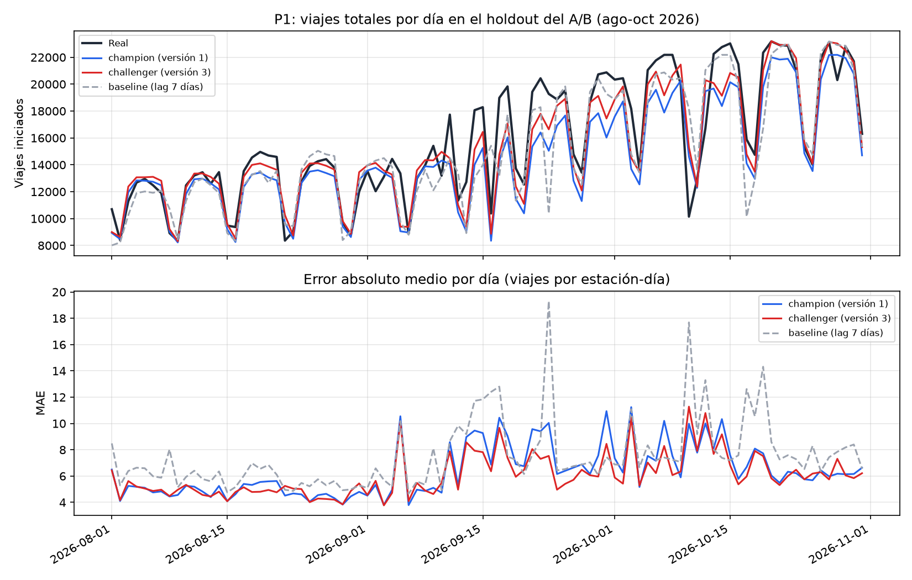

# A/B testing del modelo P1: versión 1 contra versión 3

Resumen e interpretación de la comparación entre la versión original de
`mibici-equipo32-p1-demanda` y la reentrenada. Los archivos los genera
`mibici/modeling/p1_ab_test.py`, que también registra el run `p1_ab_test` en MLflow con las
métricas, las predicciones y la decisión:

```bash
mlflow run . -e ab_test --env-manager local      # o: python -m mibici.modeling.p1_ab_test
```

| Archivo | Contenido |
|---|---|
| `p1_ab_tabla.md` | Tabla principal y decisión |
| `p1_ab_resumen.json` | Versiones comparadas, holdout, prueba estadística y decisión |
| `p1_ab_metricas.csv` | Métricas por versión, mes y segmento (estaciones existentes y nuevas) |
| `p1_ab_errores_diarios.csv` | MAE diario de cada versión, base de la prueba pareada |
| `p1_ab_diario.png` | Viajes totales y MAE por día |

## Diseño

| | |
|---|---|
| Versión A (champion al momento de la prueba) | v1, `p1_candidato_poisson_lineal`, entrenada con ene–sep 2025 |
| Versión B (challenger) | v3, `p1_v2_reentrenado`: mismo algoritmo (`PoissonRegressor`, alpha 0.001) entrenado con ene 2025 – jun 2026 |
| Referencia | Baseline ingenuo: viajes del mismo día de la semana anterior |
| Holdout | ago–oct 2026: 42,520 filas estación-día de 472 estaciones, que ninguna versión vio al entrenar |
| Tipo de prueba | Pareada y fuera de línea: cada estación-día recibe la predicción de ambas versiones |
| Regla de decisión (fijada antes de correr) | Promover el challenger solo si todo el intervalo de confianza al 95% de la diferencia de MAE queda debajo de 0 |

Como las dos versiones usan el mismo algoritmo y solo cambia la ventana de entrenamiento,
cualquier diferencia se debe a los datos. Se eligió una prueba fuera de línea en lugar de
repartir tráfico real porque el modelo apoya decisiones de planeación diarias. Con datos
históricos se evalúan las dos versiones sobre exactamente los mismos días, sin exponer la
operación a una versión peor.

## Resultados

| Métrica (ago–oct 2026) | v1 | **v3** | Baseline |
|---|---:|---:|---:|
| MAE | 6.420 | **6.071** | 7.552 |
| RMSE | 11.817 | **11.296** | 14.498 |
| WAPE | 18.8% | **17.8%** | 22.2% |
| R² | 0.911 | **0.919** | 0.866 |
| Sesgo (viajes/día) | -2.77 | **-1.22** | -1.50 |
| Error del total diario | 10.1% | **7.8%** | 10.4% |

**Prueba estadística:**

- Diferencia de MAE (v3 − v1): **−0.349 (−5.4%)**.
- Intervalo de confianza al 95%: **[−0.506, −0.201]**, con un bootstrap de 2,000 muestras que
  remuestrea días completos, porque los errores de las estaciones en un mismo día están
  correlacionados.
- Prueba de Wilcoxon sobre el MAE diario: p = 4.2×10⁻⁵.
- v3 tiene menor MAE en 62 de 92 días.

**Por mes:**

| Mes | MAE v1 | MAE v3 | Cambio | Sesgo v1 | Sesgo v3 |
|---|---:|---:|---:|---:|---:|
| Ago 2026 | 4.847 | 4.818 | −0.6% | -0.96 | 0.04 |
| Sep 2026 | 7.141 | 6.416 | −10.2% | -4.52 | -2.79 |
| Oct 2026 | 7.209 | 6.919 | −4.0% | -2.81 | -0.90 |

**Por segmento:**

| Segmento | Filas | MAE v1 | MAE v3 | Cambio |
|---|---:|---:|---:|---:|
| Estaciones que ya existían | 33,948 | 7.213 | 6.788 | −5.9% |
| Estaciones nuevas de 2026 | 8,572 | 3.282 | 3.231 | −1.5% |



## Interpretación

- La mejora es estadísticamente significativa y consistente: el intervalo completo queda debajo
  de cero y v3 gana en casi dos de cada tres días.
- Se concentra en septiembre y en las estaciones existentes, donde v3 reduce a menos de la mitad
  la subestimación de la demanda. Haber visto los datos de 2026 le permite ajustarse al nivel de
  uso más reciente.
- Ninguna versión anticipó el crecimiento de septiembre y octubre: el sesgo sigue siendo negativo.
  Por eso se recomienda reentrenar cada mes (ver
  [`reports/drift/RESUMEN.md`](../drift/RESUMEN.md)).
- En las estaciones nuevas la mejora es pequeña. Tienen poca historia y su error relativo sigue
  siendo mayor que el de las existentes, lo que está documentado como limitación en la
  [Model Card](../../MODEL_CARD.md).

## Decisión y promoción

Se cumplió la regla: **v3 pasó a `champion` y v1 quedó como `challenger`**. La promoción consistió
en cambiar `REGISTRO_MODELOS` en `config.py` y correr `register`, que movió los aliases sin borrar
versiones. Después se exportó v3 a `models/serving/p1/` para que la API la sirva.

En el registry, ambas versiones guardan la evidencia del A/B: `ab_test_run_id`,
`ab_test_decision`, `ab_test_rol` (el papel que tuvo cada una en la prueba) y
`ab_test_resultado` (v3 `ganadora`, v1 `perdedora`). `tests/test_p1_ab_test.py` comprueba que el
champion configurado sea el ganador que guarda `p1_ab_resumen.json`, para que la configuración no
contradiga la evidencia.
