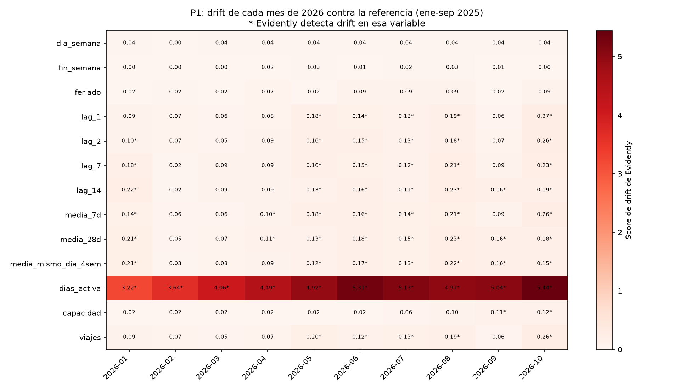

# Monitoreo de drift del modelo P1

Resumen e interpretación del reporte de drift de `mibici-equipo32-p1-demanda`. Los archivos de
esta carpeta los genera `mibici/monitoreo_drift.py` con Evidently 0.7.23, que corre en su propio
entorno (`requirements-monitoreo.txt`):

```bash
source .venv-monitoreo/Scripts/activate
python -m mibici.monitoreo_drift
```

| Archivo | Contenido |
|---|---|
| `p1_drift_reporte.html` | Reporte interactivo de Evidently: drift por variable y calidad de datos |
| `p1_drift_reporte.json` | El mismo reporte en JSON |
| `p1_drift_por_variable.csv` | Método, umbral y score de cada variable, con todo el periodo actual |
| `p1_drift_por_mes.csv` | El mismo cálculo mes por mes |
| `p1_drift_estaciones_comunes.csv` | Drift solo con las estaciones que ya existían en la referencia |
| `p1_drift_por_mes.png` | Gráfica del drift mensual |
| `resumen.json` | Cifras principales, composición de la red y pruebas de calidad |

## Qué se compara

| Conjunto | Periodo | Filas estación-día | Estaciones | Viajes promedio por estación-día |
|---|---|---:|---:|---:|
| Referencia | ene–sep 2025 (entrenamiento de la versión 1) | 90,230 | 369 | 33.0 |
| Actual | ene–sep 2026 | 107,733 | 472 | 29.8 |

Se comparan los mismos meses con un año de diferencia para que la estacionalidad no se confunda
con drift. Las variables son las 12 de entrada del modelo más la variable objetivo `viajes`.

**Método:** con muestras de este tamaño, Evidently usa la distancia de Wasserstein normalizada
para las variables numéricas y la de Jensen-Shannon para las categóricas, las dos con umbral
0.1. El conjunto se marca con drift si más del 50% de las variables lo tienen.

## Resultado general

**Hay drift en el conjunto: 9 de 13 variables (69%).**

| Variable | Score | ¿Drift? |
|---|---:|:---:|
| `dias_activa` | 4.566 | Sí |
| `media_28d` | 0.142 | Sí |
| `lag_14` | 0.136 | Sí |
| `media_mismo_dia_4sem` | 0.136 | Sí |
| `lag_7` | 0.123 | Sí |
| `media_7d` | 0.123 | Sí |
| `lag_2` | 0.109 | Sí |
| `lag_1` | 0.106 | Sí |
| `viajes` (objetivo) | 0.103 | Sí |
| `capacidad` | 0.043 | No |
| `feriado` | 0.001 | No |
| `dia_semana` | 0.001 | No |
| `fin_semana` | < 0.001 | No |

## Interpretación

**1. La causa principal es la expansión de la red, no un cambio en el comportamiento de las
personas usuarias.** En 2026 aparecieron 103 estaciones nuevas, 101 de ellas entre mayo y agosto,
con unos 10.7 viajes al día en promedio. Si el análisis se limita a las 369 estaciones que ya
existían, **ninguna variable de demanda pasa el umbral** (`viajes` queda en 0.064) y su demanda
promedio solo bajó 5.7% (de 33.0 a 31.1 viajes por día).

| Solo estaciones comunes | Score | ¿Drift? |
|---|---:|:---:|
| `dias_activa` | 4.958 | Sí |
| `media_28d` | 0.099 | No |
| `lag_14` | 0.097 | No |
| `viajes` | 0.064 | No |
| Resto de variables | < 0.1 | No |

**2. `dias_activa` cambia por cómo está construida.** Cuenta los días desde la primera salida de
cada estación dentro del panel, que empieza el 1 de enero de 2025. En el entrenamiento llegaba a
272 y en 2026 llega a 637. Es un error de diseño de la variable, no un cambio en el mundo: el
modelo lineal extrapola con esos valores. Está registrado como limitación en la
[Model Card](../../MODEL_CARD.md).

**3. El drift no es parejo en el tiempo.**

| Mes (2026) | Variables con drift | Score de `viajes` | Viajes promedio |
|---|---:|---:|---:|
| Ene | 7 | 0.087 | 30.1 |
| Feb | 1 | 0.074 | 30.7 |
| Mar | 1 | 0.050 | 31.7 |
| Abr | 3 | 0.075 | 30.7 |
| May | 9 | 0.196 | 26.5 |
| Jun | 9 | 0.123 | 29.3 |
| Jul | 9 | 0.131 | 28.9 |
| Ago | 9 | 0.188 | 26.9 |
| Sep | 5 | 0.063 | 33.4 |
| Oct | 10 | 0.256 | 41.5 |

De febrero a abril casi no hay drift. De mayo a agosto coincide con la apertura de estaciones,
que bajan el promedio por estación. En octubre la demanda crece mucho: tuvo 48% más viajes que
octubre de 2025. Se revisó que no fueran registros duplicados, porque el aumento es gradual y el
número de estaciones activas se mantiene.



**4. Calidad de datos.** No hay nulos ni columnas o filas vacías. Las 155 filas duplicadas son
días sin viajes de estaciones distintas con las mismas variables, no errores. Las estaciones 240,
405 y 407 no vienen en la nomenclatura de octubre de 2026 y quedan con capacidad 0. Las pruebas
de calidad de Evidently que fallan (`resumen.json`) comparan cuantiles y conteos contra la
referencia, así que fallan por el mismo cambio de distribución explicado arriba, no por datos
inválidos.

## Decisión tomada

El drift en las variables de demanda y en el objetivo justificó reentrenar. La versión 2 del
modelo (registrada como versión 3) usa el mismo algoritmo con la ventana ene 2025 – jun 2026 y
se comparó contra la original con un A/B sobre ago–oct 2026. Ganó y hoy está en producción. Ver
[`reports/ab_test/RESUMEN.md`](../ab_test/RESUMEN.md).

## Política de monitoreo recomendada

| Señal | Umbral | Acción |
|---|---|---|
| Drift en `viajes` o en los rezagos de las **estaciones existentes** | Score > 0.1 | Reentrenar antes del ciclo mensual |
| MAE del mes contra el de validación | Más de 15% arriba | Revisar y reentrenar |
| Estaciones nuevas | Más de 10% de las filas sin 14 días de historia | Revisar cobertura; esas estaciones no reciben predicción hasta tener historia |
| Calidad | Nulos, capacidad 0 o estaciones fuera de la nomenclatura | Corregir la ingesta antes de predecir |

El drift se mide por separado en estaciones existentes y nuevas porque, como mostró este
análisis, el drift de todo el conjunto mezcla la expansión de la red con cambios reales de
demanda. Toda versión reentrenada entra como `challenger` y solo pasa a `champion` con la regla
del A/B.
