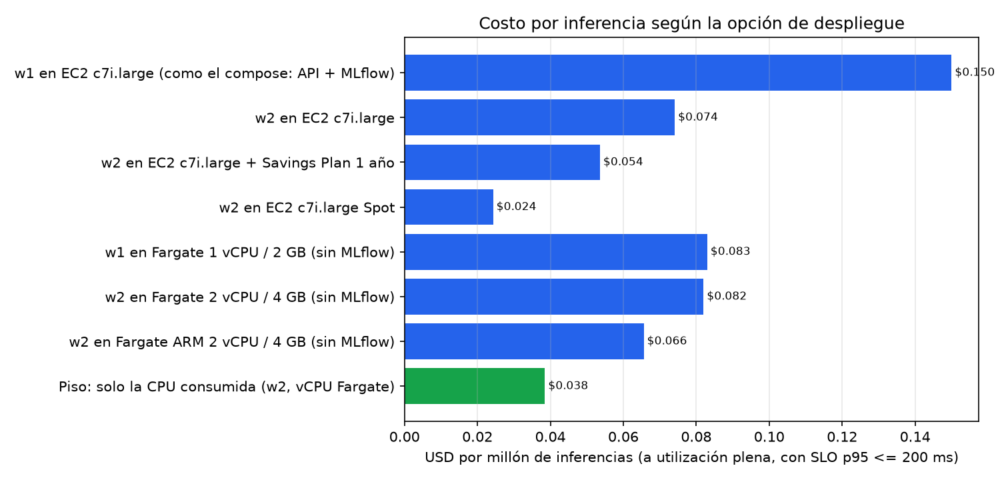
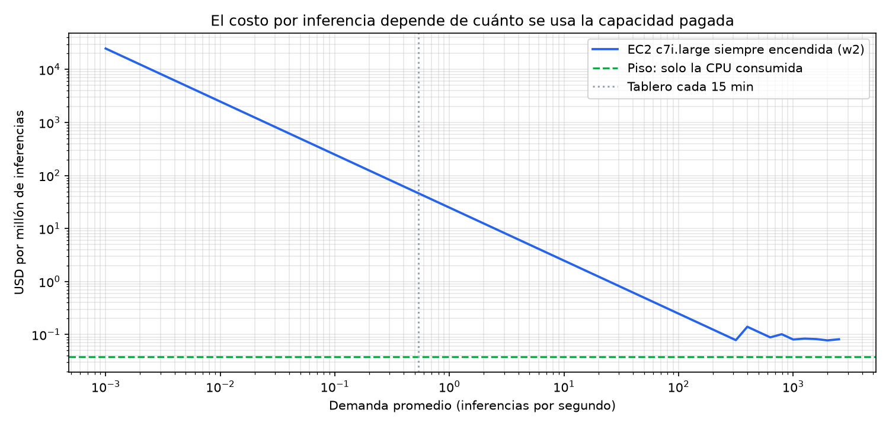

# Análisis FinOps de la API de MiBici

Este documento resume cuánto cuesta servir el modelo de demanda de P1 y qué decisiones lo
reducen. Las cifras salen de las pruebas de carga (`reports/carga/w1` y `w2`) y las calcula
`finops/costo_inferencia.py`, que también deja aquí las tablas en CSV y las gráficas. Para
actualizar el análisis basta con cambiar los precios al inicio del script y volver a correrlo:

```bash
source .venv-carga/Scripts/activate
python finops/costo_inferencia.py
```

## Metodología y supuestos

- **Costo por inferencia** = costo por hora del despliegue ÷ inferencias por hora que soporta.
- **Capacidad:** la mayor cantidad de inferencias por segundo medida cumpliendo el SLO, que es un
  p95 de 200 ms o menos y sin errores. Un lote de 10 estaciones cuenta como 10 inferencias.
- **Equivalencia de hardware:** un núcleo de la máquina local equivale a una vCPU de la nube. El
  `docker-compose.yml` limita la API a 2 CPU, igual que una instancia de 2 vCPU.
- **Precios de referencia:** AWS us-east-1, Linux, consultados en noviembre de 2026.

| Recurso | Precio |
|---|---|
| EC2 c7i.large (2 vCPU, 4 GiB) bajo demanda | 0.0892 USD/h |
| EC2 c7i.large con Compute Savings Plan de 1 año | 0.0645 USD/h |
| EC2 c7i.large Spot (varía y puede interrumpirse) | ~0.0292 USD/h |
| Fargate x86 | 0.04048 USD por vCPU-h y 0.004445 por GB-h |
| Fargate ARM (Graviton) | 0.03238 USD por vCPU-h y 0.00356 por GB-h |
| Application Load Balancer | 0.0225 USD/h, sin contar LCU |

## Capacidad medida

Fuente: `capacidad.csv` y `latencia_por_tipo.csv`.

| Configuración | Usuarios dentro del SLO | Inferencias/s en el SLO | p95 | CPU de la API | CPU por inferencia | Memoria máx. API |
|---|---:|---:|---:|---:|---:|---:|
| w1 (1 worker de uvicorn) | 50 | 165.2 | 110 ms | 55% | 3.34 ms | 202 MiB |
| w2 (2 workers) | 100 | 334.3 | 120 ms | 114% | 3.42 ms | 390 MiB |

Con 1 worker la API satura un núcleo desde 100 usuarios y deja el otro ocioso. Con 2 workers la
capacidad dentro del SLO se duplica. La CPU por inferencia casi no cambia (3.3 a 3.4 ms), así que
la ganancia viene de usar los dos núcleos, no de que cada inferencia salga más barata. MLflow
ocupa cerca de 1 GB de memoria aunque la API no lo usa para servir.

## Costo por inferencia

Fuente: `costo_por_inferencia.csv` y `costo_por_millon.png`. Capacidad usada al 100% con el SLO
cumplido.

| Opción de despliegue | USD/h | Inferencias/s | USD/mes | USD por millón |
|---|---:|---:|---:|---:|
| w1 en EC2 c7i.large (configuración inicial, API + MLflow) | 0.0892 | 165.2 | 65.12 | 0.150 |
| **w2 en EC2 c7i.large** | 0.0892 | 334.3 | 65.12 | **0.074** |
| w2 en c7i.large + Savings Plan 1 año | 0.0645 | 334.3 | 47.09 | 0.054 |
| w2 en c7i.large Spot | 0.0292 | 334.3 | 21.32 | 0.024 |
| w1 en Fargate 1 vCPU / 2 GB, sin MLflow | 0.0494 | 165.2 | 36.04 | 0.083 |
| w2 en Fargate 2 vCPU / 4 GB, sin MLflow | 0.0987 | 334.3 | 72.08 | 0.082 |
| w2 en Fargate ARM 2 vCPU / 4 GB, sin MLflow | 0.0790 | 334.3 | 57.67 | 0.066 |
| Piso: solo la CPU consumida (w2, vCPU de Fargate) | — | — | — | 0.039 |



Pasar de 1 a 2 workers en la misma instancia baja el costo por millón de 0.150 a 0.074 USD
(−51%). Fargate no gana a plena carga porque sus tamaños mínimos cobran memoria que la API no
usa. El piso de 0.039 USD es lo que costaría la CPU realmente consumida, sin capacidad ociosa.

## Utilización y escalabilidad

Fuente: `escenarios_trafico.csv` y `costo_vs_demanda.png`. Supone w2 en c7i.large bajo demanda,
más un ALB cuando hay más de una réplica.

| Escenario | Inferencias/s | Réplicas | Utilización | USD/mes | USD por millón |
|---|---:|---:|---:|---:|---:|
| Pronóstico diario de las 484 estaciones | 0.006 | 1 | 0.00% | 65.12 | 4,423 |
| Tablero que refresca las estaciones cada 15 min | 0.54 | 1 | 0.16% | 65.12 | 46.07 |
| App pública con consultas frecuentes | 50 | 1 | 15% | 65.12 | 0.50 |
| Demanda al límite de una réplica | 334 | 1 | 100% | 65.12 | 0.074 |
| Demanda alta, escalado horizontal | 1,000 | 3 | 99.7% | 211.77 | 0.081 |



Lo que más pesa en el costo es la utilización. El sistema escala de forma horizontal con un
costo casi constante: con 1,000 inferencias/s se necesitan 3 réplicas y el ALB, y el costo solo
sube de 0.074 a 0.081 USD por millón. El uso real de MiBici, en cambio, es de baja demanda: un
tablero que refresca las 484 estaciones cada 15 minutos genera 0.54 inferencias/s. Con una
instancia siempre encendida eso cuesta 46 USD por millón, unas 620 veces más que a plena carga.

## Optimizaciones

| Optimización | Evidencia | Impacto estimado | Estado |
|---|---|---|---|
| Dos workers por instancia | w1 satura un núcleo y deja otro ocioso | −51% por inferencia y el doble de capacidad en el SLO | Aplicada (`API_WORKERS=2`) |
| Pronóstico por lotes en una tarea programada | Demanda real de 0.54 inf/s, 0.16% de utilización | 96 ejecuciones diarias de 1 min en Fargate (1 vCPU, 2 GB): 2.40 contra 65.12 USD/mes (−96%) | Recomendada |
| Agrupar estaciones en lotes | Un lote de 10 tarda lo mismo que una estación (64 y 65 ms de mediana en w2) | Hasta 10 inferencias por petición con el mismo costo fijo | Disponible en la API; falta medir su impacto en el costo |
| Sacar MLflow del despliegue de servicio | 1 GB en reposo y la API no lo usa | Libera 25% de la memoria de la c7i.large | Recomendada (la API ya funciona con `MODEL_SOURCE=local`) |
| Savings Plan o Spot para la base estable | Carga continua y servicio sin estado | −28% con Savings Plan de 1 año; −67% con Spot | Recomendada si hay demanda constante |
| Imagen ARM (Graviton) | Precio de Fargate ARM | −20% frente a x86 | Requiere build `linux/arm64` en CI |

## Recomendación

- **Para la demanda actual de MiBici:** no mantener la API encendida sin uso. Generar el
  pronóstico de todas las estaciones en una tarea programada (por ejemplo, cada 15 minutos o una
  vez al día) y publicar el resultado. Cuesta alrededor de 2.40 USD/mes contra 65 USD/mes.
- **Si se abre a una app con demanda constante:** 2 workers por réplica, sin MLflow en el
  despliegue de servicio, Savings Plan para la base y autoescalado por CPU para los picos.

## Seguimiento

- Las pruebas de carga del pipeline de CI (`carga/validar_carga.py`) detectan regresiones de
  latencia antes de publicar la imagen. Si la latencia empeora, la capacidad por réplica baja y
  el costo por inferencia sube en la misma proporción.
- La CPU por inferencia (3.4 ms) es la métrica más estable para comparar versiones del modelo o
  de la API. Si un cambio la sube, el costo a plena carga sube igual.
- Los precios cambian: hay que revisarlos y volver a correr el script al menos una vez por
  trimestre.

## Referencias

- Amazon Web Services. (2026). *AWS Fargate pricing*. https://aws.amazon.com/fargate/pricing/
- FinOps Foundation. (s.f.). *FinOps for AI overview*.
  https://www.finops.org/wg/finops-for-ai-overview/
